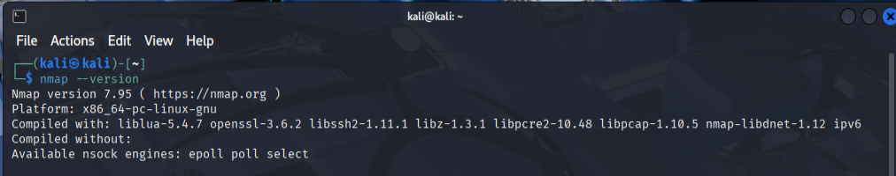
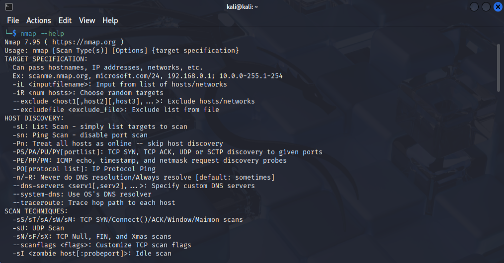
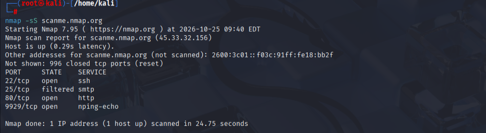
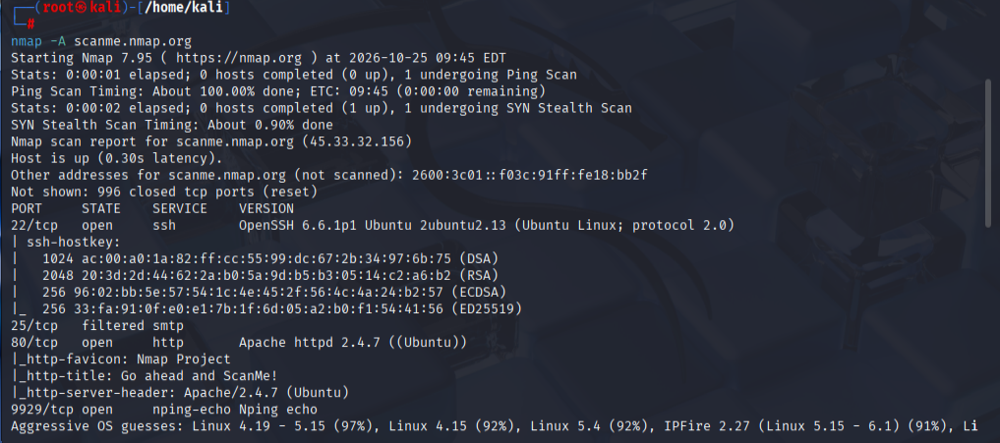

# Complete Guide to Using the Nmap Tool on Kali Linux

Nmap (Network Mapper) is the industry-standard, open-source utility used for network discovery, security auditing, and vulnerability scanning.
It works by sending raw IP packets to a target network to determine active hosts, open ports, operational services, and target operating
systems. It is the most critical tool during the active scanning phase of an engagement.

## Step 1: Verify Nmap Installation

Nmap is pre-installed on all core versions of Kali Linux. You can immediately verify its installation status and version profile using the command line.
**1\. Open your terminal window.**
**2\. Check the active version profile**

                                                            nmap --version

  

**3\. Open the general help directory to view foundational scan flags**

                                                              nmap --help

  

## Step 2: Foundational Scan Syntax
The primary command structure for running an infrastructure mapping job is:

                                       sudo nmap [Scan Type Flags] [Options] [Target IP/Domain]

**Note:** It is highly recommended to run Nmap scans with sudo privileges to allow the tool to generate and read raw network sockets.

## Step 3: Run a Real-Life Network Scan

To safely demonstrate scanning capabilities without risking unauthorized probing, security researchers utilize a public sandbox engine 
legally provided by the developer: scanme.nmap.org.
1. Execute a basic stealth scan against the live test bed domain

                                                         sudo nmap -sS scanme.nmap.org

  

Analyzing the Output
The terminal will display an organized textual output detailing the status of the remote machine:
* **Host is up:** Confirms the target server is powered on and responding to ping queries.
* **PORT / STATE / SERVICE:** Displays a structured table outlining discovery results:
  * **22/tcp open ssh** -> Indicates an active SSH management interface.
	* **80/tcp open http** -> Indicates an active unencrypted web server instance.
	* **9929/tcp open nping-echo** -> An Nmap echo testing interface.

## Step 4: Advanced Scans & Vulnerability Analysis
Nmap can be customized to perform deeply technical probes using combination argument switches.

**1\. The Aggressive System Scan (-A)**

This flag combines operating system detection (-O), version detection (-sV), script scanning (-sC), and traceroute tracking inside a single 
automated run

                                                       sudo nmap -A scanme.nmap.org

  

**2\. Service Version Discovery (-sV) and All Ports (-p-)**

By default, Nmap only evaluates the top 1,000 standard ports. To force an evaluation across every possible port (1 through 65535) and pull service 
banners, run

                                                          sudo nmap -p- -sV scanme.nmap.org

  

                                                  
**3\. Using the Nmap Scripting Engine (NSE)**

Nmap features a powerful built-in scripting sandbox called NSE. You can use it to automatically scan your targets for active vulnerabilities, malware, or open backdoors:

                                                       sudo nmap --script vuln scanme.nmap.org
                                                       
**4\. Exporting Results to Multiple Formats**
To preserve your assessment data for formal compliance reports or importing into platforms like Metasploit, use the -oA flag to export files in normal, XML, and grepable formats simultaneously:

                                             sudo nmap -sS -oA target_assessment_report scanme.nmap.org

## Step 5: Understanding Port State Results
When analyzing your Markdown data tables, pay close attention to how Nmap labels the state of an open port:

                Port State	                     Technical Meaning                           	Action Step
                 
				  Open	            An application is actively accepting           Investigate service versions for known exploits.
                                              connection packets.	
                  Closed	        The port is accessible but no service          Safe, but confirms host availability.
                                                is listening.	
                  Filtered	        A firewall or network filter is blocking       Requires firewall evasion strategies.
                                                  the probe.	                      
                  Unfiltered	    The port is accessible, but Nmap cannot        Use alternative scan types like ACK scans.
				                        determine if it is open or closed.	

